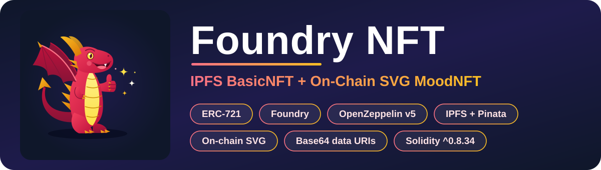
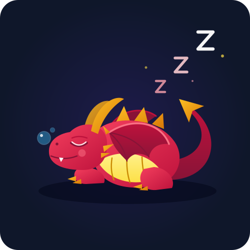
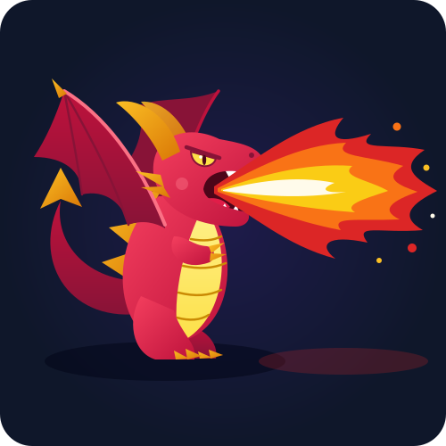
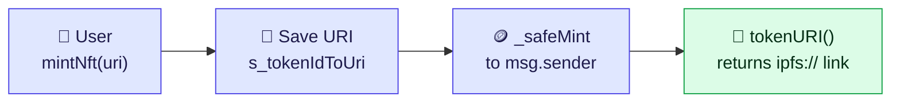
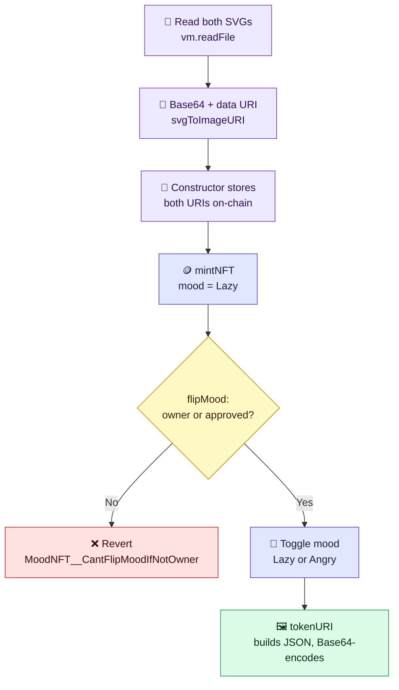
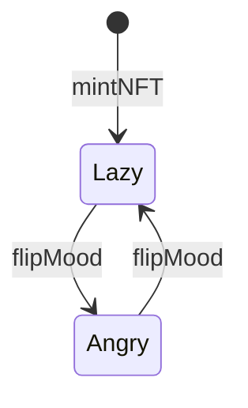

<p align="center">
  
</p>

<p align="center">
  <b>Two ERC-721s, two ways to store an image:</b><br />
  off-chain on IPFS, or fully on-chain as a Base64 SVG that changes with a mood.
</p>

<p align="center">
  <a href="#-overview">🎯 Overview</a> &nbsp;·&nbsp;
  <a href="#-preview">📸 Preview</a> &nbsp;·&nbsp;
  <a href="#-architecture">📐 Architecture</a> &nbsp;·&nbsp;
  <a href="#-tests">🧪 Tests</a> &nbsp;·&nbsp;
  <a href="#-quick-start">⚡ Quick Start</a>
</p>

<p align="center">
  <b>👨‍💻 Developer:</b> Yuvraj Singh &nbsp;|&nbsp;
  <b>📚 Based on:</b> <a href="https://updraft.cyfrin.io/">Cyfrin Updraft</a> Foundry course (Patrick Collins)
</p>

---

## 📑 Contents

1. [🎯 Overview](#-overview)
2. [📸 Preview](#-preview)
3. [🐶 BasicNFT (IPFS)](#-basicnft-ipfs)
4. [🐉 MoodNFT (On-Chain SVG)](#-moodnft-on-chain-svg)
5. [📐 Architecture](#-architecture)
6. [🚀 Scripts](#-scripts)
7. [🧪 Tests](#-tests)
8. [📁 Project Structure](#-project-structure)
9. [⚡ Quick Start](#-quick-start)
10. [🙏 Acknowledgements](#-acknowledgements)
11. [📄 License](#-license)

---

## 🎯 Overview

Two ERC-721 contracts, built with Foundry, that solve the same problem in different ways: *where does the image live?*

Putting a normal `.jpg` or `.png` on Ethereum costs far too much gas, so this repo builds both common workarounds.

| | 🐶 `BasicNFT` | 🐉 `MoodNFT` |
| :--- | :--- | :--- |
| **Image lives** | Off-chain, on IPFS | On-chain, as a Base64 SVG data URI |
| **JSON metadata** | Off-chain, on IPFS | Built inside `tokenURI()` |
| **Can it change?** | No, always the same file | Yes, `flipMood()` swaps the image |
| **Deploy gas** | Low | Higher (stores two SVG strings) |
| **If IPFS goes down** | Image may not load | Unaffected, it lives on Ethereum |

---

## 📸 Preview

### 🐶 BasicNFT: image stored off-chain

<p align="center">
  
  <br />
  <b>Toy Pomeranian</b>
  <br />
  <sub>pinned on IPFS via Pinata</sub>
</p>

> [!NOTE]
> This image is **not** stored on Ethereum. Only a link to its IPFS metadata is saved in the contract, and `tokenURI()` returns that link. The picture stays the same forever, and it only loads while some IPFS node is still pinning it.

### 🐉 MoodNFT: image stored on-chain

<table align="center">
  <tr>
    <td align="center">
      
      <br />
      <b>😴 Mood.Lazy</b>
      <br />
      <sub>default after minting</sub>
    </td>
    <td align="center">
      
      <br />
      <b>😡 Mood.Angry</b>
      <br />
      <sub>after <code>flipMood()</code></sub>
    </td>
  </tr>
</table>

> [!NOTE]
> These are the **same NFT in two states**, not two separate tokens. Both SVGs are Base64-encoded and stored inside the contract, so the artwork needs no website or IPFS node. Calling `flipMood(tokenId)` switches which one `tokenURI()` returns, so the image shown by wallets and marketplaces changes with it.

---

## 🐶 BasicNFT (IPFS)

A standard ERC-721 (`Doggy` / `DOG`) built on OpenZeppelin. You pass an IPFS metadata link when minting, and the contract stores it against the new `tokenId`. `tokenURI()` just returns that link.

| | |
| :--- | :--- |
| 🖼️ **Image CID** | `ipfs://bafkreieadlx33lrukitgkaufhzs3e2zwrq67iwqffjzg2f72ifsmyoq4qi` |
| 📄 **Metadata CID** | `ipfs://bafkreihmp2sv6fojjzliornxg52o7yzufvq3tdu5jf7ynohqyf5c66lare` |

Metadata pinned to IPFS ([`img/toy_pom.json`](img/toy_pom.json)):

```json
{
    "name": "Toy Pomeranian",
    "description": "An adorable, fluffy pure white Toy Pomeranian puppy!",
    "image": "ipfs://bafkreieadlx33lrukitgkaufhzs3e2zwrq67iwqffjzg2f72ifsmyoq4qi",
    "attributes": [
        { "trait_type": "cuteness", "value": 100 }
    ]
}
```

---

## 🐉 MoodNFT (On-Chain SVG)

A dynamic NFT (`MoodNFT` / `MN`) where the art **and** the metadata live fully on-chain. Nothing depends on a website or an IPFS node.

| Mood | Artwork | How you get there |
| :--- | :--- | :--- |
| 😴 `Mood.Lazy` (default) | Curled up, sleeping, Zzz's and sleep bubbles | Set on `mintNFT()` |
| 😡 `Mood.Angry` | Roaring, raised wings, fangs, fire breath | `flipMood(tokenId)` |

Calling `flipMood(tokenId)` toggles between the two. Only the token's owner or an approved address can do it; anyone else hits the custom error `MoodNFT__CantFlipMoodIfNotOwner`.

### 🔄 Encoding pipeline

The SVGs are Base64-encoded once at deploy time and stored. The JSON is built and encoded fresh on every `tokenURI()` call.

```text
┌──────────────────────────────────────────────────────────────────┐
│ 1. DEPLOY TIME   script/DeployMoodNFT.s.sol                      │
├──────────────────────────────────────────────────────────────────┤
│                                                                  │
│ lazy_dragon.svg   angry_dragon.svg                               │
│        |                                                         │
│        |  vm.readFile()                                          │
│        v                                                         │
│ raw SVG text                                                     │
│        |                                                         │
│        |  Base64.encode(...)                                     │
│        v                                                         │
│ "PHN2ZyB4bWxucz0iaHR0cDovL3d3dy53My5vcmcvMjAwMC9zdmci..."        │
│        |                                                         │
│        |  prepend "data:image/svg+xml;base64,"                   │
│        v                                                         │
│ s_lazySvgImageURI   s_angrySvgImageURI                           │
│ (both saved in contract storage by the constructor)              │
│                                                                  │
└──────────────────────────────────────────────────────────────────┘
                                 │
                                 ▼
┌──────────────────────────────────────────────────────────────────┐
│ 2. VIEW TIME   src/MoodNFT.sol -> tokenURI(tokenId)              │
├──────────────────────────────────────────────────────────────────┤
│                                                                  │
│ s_tokenIdToMood[tokenId]                                         │
│        |                                                         │
│        +-- Mood.Lazy  --> imageURI = s_lazySvgImageURI           │
│        +-- Mood.Angry --> imageURI = s_angrySvgImageURI          │
│        |                                                         │
│        v                                                         │
│ abi.encodePacked( JSON text + imageURI )                         │
│   {"name": "MoodNFT", "description": "...",                      │
│    "attributes": [...], "image": "<imageURI>"}                   │
│        |                                                         │
│        |  Base64.encode(...)                                     │
│        v                                                         │
│ prepend _baseURI() = "data:application/json;base64,"             │
│        |                                                         │
│        v                                                         │
│ returns "data:application/json;base64,eyJuYW1lIjog..."           │
│                                                                  │
└──────────────────────────────────────────────────────────────────┘
```

---

## 📐 Architecture

### 🐶 BasicNFT flow



### 🐉 MoodNFT flow



### 🎭 Mood state machine



---

## 🚀 Scripts

### 📖 `DeployMoodNFT.s.sol`

Instead of pasting large SVGs into Solidity, the script reads them from disk with Foundry's `vm.readFile()`:

```solidity
string memory LazySvg = vm.readFile("./img/lazy_dragon.svg");
string memory AngrySvg = vm.readFile("./img/angry_dragon.svg");
```

Foundry blocks file reads by default, so `foundry.toml` grants access:

```toml
fs_permissions = [
    { access = "read", path = "./broadcast" },
    { access = "read", path = "./img" },
]
```

`svgToImageURI()` then turns both SVGs into Base64 data URIs and passes them to `new MoodNFT(...)`.

### 🤝 `Interactions.s.sol`

| Script | What it does |
| :--- | :--- |
| `MintBasicNFT` | Mints the Toy Pomeranian NFT on the deployed `BasicNFT` |
| `MintMoodNFT` | Mints a new dragon on the deployed `MoodNFT` |
| `FlipMoodNFT` | Flips the mood of token `0` (`TOKEN_ID_TO_FLIP`) |

All three use `DevOpsTools.get_most_recent_deployment(...)` from `foundry-devops`, which scans `./broadcast` for the latest deployment on the current `block.chainid`. No pasting contract addresses by hand.

---

## 🧪 Tests

Unit tests cover isolated functions and Base64 conversion. Integration tests run the real deploy scripts and check state changes.

| File | Test | What it checks |
| :--- | :--- | :--- |
| `BasicNFTtest.t.sol` | `testNameIsCorrect` | Deploys via script, compares the hashed `name()` to `"Doggy"` |
| `BasicNFTtest.t.sol` | `testCanMintAndHaveABalance` | Mints as `USER`; checks `balanceOf(USER) == 1` and `tokenURI(0) == TOY_POM` |
| `DeployMoodNFTtest.t.sol` | `testConvertSvgToUri` | Checks `svgToImageURI()` output for a small `<svg>` string |
| `MoodNFTtest.t.sol` | `testViewTokenURI` | Mints token `0` as `USER` and logs `tokenURI(0)` |
| `MoodNftIntegrationTest.t.sol` | `testViewTokenURIIntegration` | Deploys with the real dragon SVGs and logs `tokenURI(0)` |
| `MoodNftIntegrationTest.t.sol` | `testFlipTokenToAngry` | Mints, calls `flipMood(0)`, checks the URI changed |

> 💡 Solidity can't compare strings with `==`, so the tests compare `keccak256` hashes of the packed bytes instead.

> 🚧 More tests are on the way.

---

## 📁 Project Structure

```text
foundry-NFT/
├── foundry.toml                    # settings, remappings, file permissions
├── Makefile                        # build, test, deploy, mint, flip
├── .env.example                    # template for Sepolia secrets
├── LICENSE                         # MIT
├── img/
│   ├── lazy_dragon.svg             # Mood.Lazy artwork
│   ├── angry_dragon.svg            # Mood.Angry artwork
│   ├── toy_pom.jpg                 # Pomeranian image (pinned to IPFS)
│   ├── toy_pom.json                # Pomeranian metadata (pinned to IPFS)
│   ├── sleeping_uri.txt            # saved Base64 URI, sleeping dragon
│   └── angry_uri.txt               # saved Base64 URI, angry dragon
├── src/
│   ├── BasicNFT.sol                # ERC-721 using IPFS links
│   └── MoodNFT.sol                 # dynamic on-chain SVG ERC-721
├── script/
│   ├── DeployBasicNFT.s.sol
│   ├── DeployMoodNFT.s.sol
│   └── Interactions.s.sol          # MintBasicNFT, MintMoodNFT, FlipMoodNFT
└── test/
    ├── integrations/
    │   ├── BasicNFTtest.t.sol
    │   └── MoodNftIntegrationTest.t.sol
    └── unit/
        ├── DeployMoodNFTtest.t.sol
        └── MoodNFTtest.t.sol
```

---

## ⚡ Quick Start

**Prerequisites:** [Foundry](https://book.getfoundry.sh/getting-started/installation) installed.

### 🔨 Build & test

```bash
make install
make build

make test          # run all tests
forge test -vv     # also print console.log output (the Base64 tokenURI)
```

### 🏠 Run locally on Anvil

```bash
# Terminal 1
make anvil

# Terminal 2: BasicNFT
make deploy
make mint

# Terminal 2: MoodNFT
make deployMood
make mintMoodNft
make flipMoodNft
```

### 🌐 Deploy to Sepolia

Copy `.env.example` to `.env` and fill in `SEPOLIA_RPC_URL`, `PRIVATE_KEY` and `ETHERSCAN_API_KEY`. Never commit `.env`.

```bash
# BasicNFT
make deploy ARGS="--network sepolia"
make mint ARGS="--network sepolia"

# MoodNFT
make deployMood ARGS="--network sepolia"
make mintMoodNft ARGS="--network sepolia"
make flipMoodNft ARGS="--network sepolia"
```

---

## 🙏 Acknowledgements

This project is **based on** the NFT section of [Patrick Collins'](https://github.com/PatrickAlphaC) Foundry Full Course on [Cyfrin Updraft](https://updraft.cyfrin.io/), which is where I learned the core ideas: IPFS-backed ERC-721s, on-chain SVG metadata, Base64 data URIs, and Foundry scripts and tests. Huge thanks to Patrick and the Cyfrin team for making it free.

It isn't a copy of the course repo. I rebuilt it with my own theme (a Toy Pomeranian, a Lazy/Angry dragon with custom artwork), my own naming and file layout, OpenZeppelin v5.0.2 (using `_isAuthorized`), and my own docs and tests.

---

## 📄 License

[MIT](LICENSE) © 2026 Yuvraj Singh
